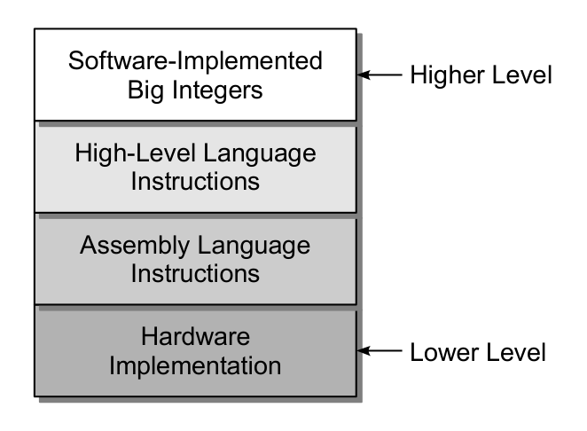
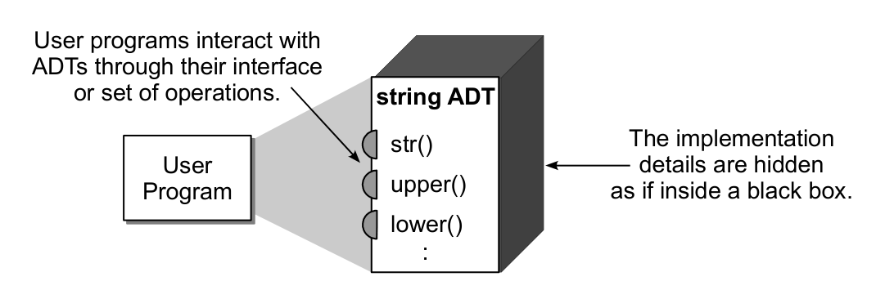
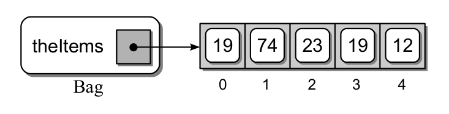
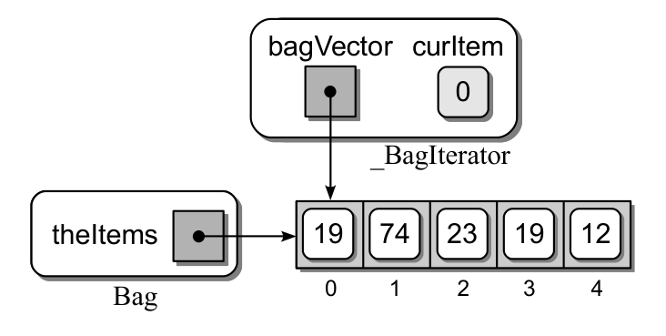

# Chapter 1 — Abstract Data Types

_Rance D. Necaise, *Data Structures and Algorithms Using Python*, Chapter 1 (book pages 1–32) · chapter notes in the book's order, with the questions I had along the way_

Companions: **[Chapter 1 Exercises](<Chapter 1 Exercises.md>)** (all exercises and programming projects, solved) · **[first-pass summary](<Abstract Data Types (DSA Ch. 1).md>)** (the book's full code listings).

---

> [!info] Chapter Essence
> The whole chapter is one idea: **separate *what* a type does from *how* it does it.** An **abstract data type (ADT)** names a set of values and the operations allowed on them. A **data structure** is one concrete way to store those values. Code that uses an ADT only through its operations keeps working when the inside is replaced. The chapter builds three examples: a **Date** (a simple ADT), a **Bag** (a container, plus an **iterator** so `for` loops work on it), and a **Student File Reader** that hides how records are stored on disk.

**Before §1.1, the book sets the scene.** An **algorithm** is a clear, precise, step-by-step procedure that solves a problem in a finite amount of time. **Programming** is translating an algorithm into a program a computer can run. Computer science is the study of algorithms, not of programming or of any one language; those are tools for solving problems.

---

## 1.1 Introduction

Inside a computer every value is a string of bits, and the same bits could be a number, some characters or a real number. Types give the bits a meaning.

> [!definition] Types
> | Term | Meaning |
> |---|---|
> | **Type** | A collection of values |
> | **Data type** | A type **plus** the operations for working with its values |
> | **Primitive** | A data type built into the language |
> | **Simple** primitive | One value that can't be split into smaller parts: integers, reals |
> | **Complex** primitive | Built from several parts: in Python, objects, strings, lists, dictionaries |
> | **User-defined type** | A type the programmer creates when the built-in ones aren't enough for a large problem |

### 1.1.1 Abstractions

> [!definition] Abstraction
> An **abstraction** separates an object's properties and keeps only the ones that matter right now. You can use the object without understanding all of its details.
>
> | Kind | You know… | …but ignore | Book's example |
> |---|---|---|---|
> | **Procedural** (functional) abstraction | what a function or method does | how it does it | the square-root function |
> | **Data** abstraction | a data type's values and operations | how the type is implemented | Python strings |

**Abstractions come in layers**, each hiding the one below. Figure 1.1 shows the layers used for integer arithmetic:



| Layer (low → high) | What you work with | Who works here |
|---|---|---|
| **Hardware** | binary values and logic circuits | hardware designers, who must make arithmetic correct |
| **Assembly language** | one machine instruction at a time | compiler writers and assembly programmers |
| **High-level language** | a primitive integer type and familiar expressions like `x = a + b - 5` | everyday programmers |
| **Software big integers** | integers of unlimited size | anyone who needs numbers too big for the hardware |

In assembly, `x = a + b - 5` becomes five separate steps: load `a` from memory into a register, load `b` into another, add them, subtract 5, and store the result back into `x`. The high-level layer exists so you never write those steps yourself.

**Why the top layer exists:** hardware integers have a fixed size. On a 32-bit machine a signed integer only covers $-2^{31}$ to $2^{31}-1$. **Big integers** store the digits in software and implement the arithmetic as functions, built from the layer below. Most languages provide them in a library; Python builds them in, so `2 ** 100` just works and prints `1267650600228229401496703205376`.

> [!question] Question I had — How does `x = a + b - 5` turn into those assembly instructions?
> A **translator** sits between the layers. A **compiler** (C, C++, Rust) translates the whole program into machine code before it runs. An **interpreter** (Python) translates as it runs; Python first turns your code into compact **bytecode**, which the Python runtime executes. The translator has a ready-made pattern for each operation (`+` becomes an add instruction, `a > b` becomes compare-and-jump) and fills in your variables. That's the bridge between the high-level and assembly layers of Figure 1.1.

> [!question] Question I had — If the CPU only knows numbers, where do strings, lists and booleans come from?
> The language **encodes** them as numbers. That's data abstraction at the lowest level:
> - **Strings:** each character is stored as its code number, so `"CAT"` is `67, 65, 84` in three consecutive slots.
> - **Lists:** values sit in consecutive memory slots, and the language remembers where they start.
> - **Booleans:** `True` is `1` and `False` is `0`.
>
> Every high-level feature, arithmetic and data types alike, ends up as moving and combining numbers in memory.

### 1.1.2 Abstract Data Types

> [!definition] Abstract data type (ADT)
> A **programmer-defined** data type that specifies a set of values and a collection of well-defined operations on them, **independent of any implementation**.
> - Users interact with it only through its **interface**, the defined set of operations.
> - Hiding the implementation this way is called **information hiding**.

An ADT works like a **black box**. A user program (also called the **client**) calls the operations on the outside and never sees the inside:



> [!definition] The four categories of operations
> | Category | What it does | Date (§1.2) | Bag (§1.3) | Python you already use |
> |---|---|---|---|---|
> | **Constructor** | creates and initializes a new instance | `Date(10, 31, 2023)` | `Bag()` | `list()`, `dict()` |
> | **Accessor** | returns data **without changing** the instance | `day()`, `monthName()` | `len(bag)`, `x in bag` | `len(nums)`, `s.upper()` |
> | **Mutator** | **changes** the instance | `advanceBy(days)` | `add`, `remove` | `nums.append(x)`, `nums.sort()` |
> | **Iterator** | processes the items one at a time | — | `for x in bag` (§1.4) | `for` loops |
>
> A type with **no mutators** can never change after it's built. That's why `s.upper()` returns a *new* string: Python strings are immutable.

**Four advantages of focusing on the "what"**, all using the book's example of reading values from a file and keeping them for later:

| Advantage | What goes wrong without it |
|---|---|
| **Focus** on the problem, not the implementation | You worry about which storage structure to use, how, and whether it's efficient |
| **Fewer logic errors**, since nobody can touch the internals directly | Some part of the code changes the list by accident, and the bug is hard to find |
| **Swap the implementation** without changing the code that uses it | If you later want the values kept in a different order, you must fix every place that adds to the list |
| **Easier teamwork**: modules agree on the ADT's definition | Team members organize or modify the shared list in different ways, and the combined program misbehaves |

> [!tip] The analogy that makes it click: a television
> The **ADT** is the idea of a TV. The **interface** is the remote: power, volume, channel. You, pressing the buttons, are the **client**. The **data structure and implementation** are the wires and chips inside. Buy a TV with a better screen and the same remote still works. That's the payoff of separating "what" from "how".

### 1.1.3 Data Structures

At some point an ADT needs a concrete implementation, and the choices you make affect what it can do and how fast it is. Python's library ADTs are implemented by the library's maintainers; your own ADTs are implemented by you.

- **Simple ADT:** a few individually named fields, e.g. a date or a rational number.
- **Complex ADT:** a collection of values, e.g. Python's list or dictionary. Complex ADTs are built on a **data structure**: the physical way the data is organized and manipulated.
- Common data structures: **arrays, linked lists, stacks, queues, trees**. They all store a collection; they differ in how they organize it and which operations they allow.
- **The right one depends on the problem:** a **queue** fits a printer queue, and a **B-tree** fits a database index. Because the ADT's definition is separate, you can switch structures later without rewriting the code that uses it.

### 1.1.4 General Definitions

| Term | Meaning | Python examples |
|---|---|---|
| **Collection** | A group of values with no implied organization | — |
| **Container** | Any data structure or ADT that stores and organizes a collection. Its values are **elements**; with none it is **empty** | strings, tuples, lists, dictionaries, sets |
| **Sequence** | A container whose elements are in a **linear order**, front to back, each reachable **by position** with the subscript operator `[ ]` | immutable: `str`, `tuple`; mutable: `list` (arrays come in Chapter 2) |
| **Sorted sequence** | A sequence whose order follows a rule relating each element to the next, e.g. smallest to largest | — |
| **List** (general) | Any linearly ordered collection: every element except the first has one predecessor, and every element except the last has one successor | — |

> [!warning] Two meanings of "list"
> Every sequence is a list, but a list need not be a sequence, because a list doesn't have to offer access by position. Python uses the name `list` for what other languages call an array list or vector. The book says **list** for Python's type and **general list** or **list structure** for the general idea.

---

## 1.2 The Date Abstract Data Type

An ADT is defined by its **domain** (the values it can hold) and the **operations** on that domain. Only the listed operations may be used on an instance.

### 1.2.1 Defining the ADT

The **Gregorian calendar** was introduced in 1582 by Pope Gregory XIII to replace the Julian calendar. It corrected the length of the year and introduced the leap-year rule. Its first official day was **Friday, October 15, 1582**. The **proleptic** Gregorian calendar extends it backwards so that older dates can be handled the same way, starting on **November 24, 4713 BC**.

> [!definition] The Date ADT: one day in the proleptic Gregorian calendar
> | Operation | What it does |
> |---|---|
> | `Date( month, day, year )` | Constructor: creates a date. The date **must be valid**. Years 1 BC and earlier are negative |
> | `day()`, `month()`, `year()` | The Gregorian day, month and year |
> | `monthName()` | The month's name |
> | `dayOfWeek()` | The day of the week, 0 (Monday) to 6 (Sunday) |
> | `numDays( otherDate )` | The number of days between the two dates, as a positive integer |
> | `isLeapYear()` | Whether the date falls in a leap year |
> | `advanceBy( days )` | Moves the date forward (positive `days`) or back (negative); it never goes before the calendar's first day |
> | *comparable* `( otherDate )` | Orders two dates with `<`, `<=`, `>`, `>=`, `==`, `!=` |
> | *toString* `()` | The date as `mm/dd/yyyy`, produced by `str()` |

**How the book writes ADTs:**
- Every ADT is implemented as a **Python class**. The operations are listed as **method prototypes**, and the constructor carries the class's name.
- Some operations are implemented as **Python operators** instead of named methods. The book prints those in italics, like *comparable* and *toString* above. The definition stays language-neutral, while the Python code reads naturally (`d1 < d2`, `print(d)`).
- Book note: classes are reviewed in Appendix D.

> [!warning] 4713 BC or 4714 BC?
> The book writes "November 24, 4713 BC" here, but "4714 BC" in `advanceBy`. Both refer to the same day, Julian day 0. Astronomers count a year 0 (year 0 = 1 BC), so that day is year −4713 in the formula, which is 4714 BC in everyday terms.

### 1.2.2 Using the ADT

**The program (Listing 1.1, `checkdates.py`):** read birth dates from the user and print those of people who are at least 21, stopping when the user enters 0 for the month. The key lines, in short:

```python
bornBefore = Date(6, 1, 1988)          # latest birth date that still counts as 21
date = promptAndExtractDate()          # a Date, or None when the user enters month 0
while date is not None:
    if date <= bornBefore:             # the ADT's "comparable" operation
        print("Is at least 21 years of age: ", date)
    date = promptAndExtractDate()
```

The point: the program only uses the interface. **Any** implementation of the Date ADT would leave these lines unchanged.

> [!question] Question I had — How does it check "at least 21" without ever computing an age?
> It **turns the question around**. Computing an age is messy (leap years, month lengths, whether the birthday has passed yet). Instead, a person works out once that anyone born **on or before June 1, 1988** is 21 on the book's "today", June 1, 2009, and hard-codes that date. Then each check is a single comparison, `date <= bornBefore`. For birth dates, **earlier means older**, and the boundary counts: someone born exactly on 06/01/1988 qualifies.
>
> The loop is a **sentinel loop**: `promptAndExtractDate()` returns a `Date` or `None`, and the loop runs until `None` appears.

### 1.2.3 Preconditions and Postconditions

> [!definition] Preconditions and postconditions
> - **Precondition:** what must be true of the instance and the inputs **before** an operation can run. It is assumed to hold.
> - **Postcondition:** the result or state **after** the operation. It is guaranteed, as long as the preconditions held.
> - Calling an operation when its precondition is false is an **error** and should be flagged.

| Operation | Precondition | Postcondition |
|---|---|---|
| list `pop(i)` (the book's example) | `i` is a legal index | the item is removed; an illegal index raises an exception |
| `Date(month, day, year)` | the three values form a valid date | a new date exists |
| `day()` | the date has been created | none: an accessor changes nothing |
| *every* operation | the instance has been initialized | — |

The last row is automatic in an object-oriented language: an object can't be used before its constructor has run. The book doesn't spell out pre- and postconditions for each operation; you can read them from the descriptions.

**How to enforce preconditions:** test them and **raise an exception** when one fails. The *user* of the ADT then decides whether to catch it or let the program stop.
- An **exception** is an event signalling an error; if no code catches it, the program aborts.
- `assert condition, "message"` raises an `AssertionError` when the condition is false. The book uses `assert` throughout, so it can focus on the ADTs instead of choosing exception types. (Appendix C covers exceptions; see also [The Assert Statement](<The Assert Statement.md>).)

```text
>>> Date(2, 30, 2023)
AssertionError: Invalid Gregorian date.
```

### 1.2.4 Implementing the ADT

The book gives a **partial** `Date` class (Listing 1.2) and leaves the rest as exercises. The complete class, with every operation, is in [Exercise 1.1](<Chapter 1 Exercises.md>).

**Date representations: two choices.**

| Store the date as… | Easy | Hard |
|---|---|---|
| **Three fields:** month, day, year | reading each part | comparing dates; counting days between them (months have different lengths) |
| **One integer: the Julian day number**, the days since Nov 24, 4713 BC | comparing (compare integers); days between (subtract) | reading the parts: they must be computed back from the integer |

The book picks the **Julian day number**: it's common in real software and makes the implementation easy.


**Constructing the Date.** The class has a single attribute, `_julianDay`. The constructor:
1. **checks the precondition** with `assert self._isValidGregorian(month, day, year)`. That helper is left as an exercise;
2. **converts** the date with a published astronomy formula (Seidelmann, *Explanatory Supplement to the Astronomical Almanac*), where day 0 is November 24, 4713 BC and every division is integer division:

```text
T    = (M - 14) / 12
jday = D - 32075 + (1461 * (Y + 4800 + T) / 4)
                 + (367 * (M - 2 - T * 12) / 12)
                 - (3 * ((Y + 4900 + T) / 100) / 4)
```

Check: `Date(1, 1, 2000)` stores **2451545**, the standard Julian day number for that date.

> [!question] Question I had — Why does the constructor use a `tmp` variable instead of the formula's first line?
> The formula assumes integer division **truncates toward zero**, but Python's `//` **rounds down** (toward negative infinity). For negative numbers they disagree:
>
> | Month | `T` the formula needs | Python's `(M - 14) // 12` |
> |---|---|---|
> | January | −1 (−13/12 truncated) | **−2**: wrong |
> | February | −1 (−12/12) | −1: right |
> | March–December | 0 (e.g. −11/12 truncated) | **−1**: wrong |
>
> Since `T` can only be −1 (January, February) or 0 (other months), the book replaces that line with `tmp = -1 if month < 3 else 0` (written as an `if`). Lesson: when you copy a formula into another language, check what its operators actually do.

> [!note] Book notes in this part
> - **Comments:** real classes should be commented. The book leaves most comments out to save space, because the text explains the code.
> - **Protected attributes and methods (caution box):** Python can't hide attributes. A name starting with **one underscore** (`_julianDay`, `_toGregorian`) means "internal; don't touch from outside". The user is trusted to respect it.

**The Gregorian date.** Several operations need the reverse conversion, from Julian day back to month/day/year. Instead of repeating that formula, the helper `_toGregorian()` does it once and **returns a tuple** `(month, day, year)`. Each accessor picks its part: `month()` returns element `[0]`, `day()` element `[1]`, `year()` element `[2]`.
- `dayOfWeek()` also calls `_toGregorian()`, then applies a short formula. That formula treats January and February as months 13 and 14 of the previous year, and gives 0 = Monday … 6 = Sunday. It returns **4 (Friday)** for October 15, 1582, matching history.
- *toString* is implemented by overloading `__str__`, which formats the tuple as `mm/dd/yyyy`. Python calls it automatically, so `print(Date(9, 1, 2006))` prints `09/01/2006`.

**Comparing Date objects.** With Julian days, comparing two dates is comparing two integers. Defining the comparison operators makes Date objects **comparable**: they have a logical ordering. The book defines only **three**, `__eq__`, `__lt__` and `__le__`, because Python 3 fills in the rest:

| You write | Python actually calls |
|---|---|
| `a > b` | `b < a` (swaps the operands: the **reflected** operator) |
| `a >= b` | `b <= a` |
| `a != b` | `not (a == b)` |

So you only need one operator from each pair: `<` or `>`, `<=` or `>=`, `==` or `!=`.

> [!tip] Book tip — overloading operators
> Classes can define operators such as `+`, `*`, `%`, `==`, `in` and `not in`, which reads more naturally than calling named methods. Only define an operator where it **means something** for that class.

---

## 1.3 Bags

The Date was a **simple** ADT. The Bag is a **complex** one, a container. Like a shopping bag, it holds a collection, and it only lets you **add** items, **remove** items, **check** whether an item is inside, and **go through** all of them.

### 1.3.1 The Bag Abstract Data Type

**Three kinds of bag.** The **simple bag** (this one); the **grab bag**, which removes items at random; and the **counting bag**, which can also report how many copies of an item it holds. The last two are programming projects.

> [!definition] The Bag ADT
> A container that stores a collection in which **duplicates are allowed**. Each item is stored individually, items have **no particular order**, and they must be **comparable**.
>
> | Operation | What it does | Python form |
> |---|---|---|
> | `Bag()` | Creates an empty bag | `Bag()` |
> | *length* `()` | The number of items | `len(bag)` |
> | *contains* `( item )` | Whether the item is in the bag | `item in bag` |
> | `add( item )` | Adds the item | `bag.add(item)` |
> | `remove( item )` | Removes **one** copy of the item and returns it; raises an exception if it isn't there | `bag.remove(item)` |
> | *iterator* `()` | Returns an iterator for going through the items | `for x in bag` |

**Why no *toString*?** Building a string for a huge collection takes a lot of time and memory. A `__str__` method helps while debugging, but production code wouldn't normally use it, so the book usually leaves it out.

**Examples.**
- **Guessing game:** add 19, 74, 23, 19 and 12 to a bag, then ask the user to guess a value and test it with `value in myBag`. The program never needs to know how the bag stores anything.
- **Birth dates, version 2 (`checkdates2.py`):** store each entered date in a bag first, then check them afterwards with `for date in bag:`, without asking the user to type them again. A bag is ideal whenever order and position don't matter.

> [!tip] Why a Bag ADT, when a list would do?
> The book admits that a plain list is fine for a small program. In larger programs and teams, the bag abstraction lets you:
> 1. focus on the problem, not the container;
> 2. avoid misusing the list's extra operations, such as indexing and sorting, that a bag shouldn't allow;
> 3. coordinate better between modules and team members;
> 4. swap in a different, maybe faster, implementation later.

### 1.3.2 Selecting a Data Structure

Implementing a complex ADT means choosing a data structure. The book's **three questions** for judging a candidate:

> [!definition] Is this data structure suitable?
> 1. **Storage:** can it store every value in the ADT's domain, respecting any restrictions?
> 2. **Functionality:** can it implement **every** operation **without exposing** the implementation to the user?
> 3. **Efficiency:** does it allow an efficient implementation? This picks the best among several suitable structures.
>
> Often several structures are suitable, and the best one depends on the **context**. That's why language libraries often offer several implementations of the same ADT, and why the book gives several implementations as it introduces new structures.

Efficiency needs **complexity analysis**, which comes later. The book's text says Chapter 3, but in this edition it's **Chapter 4, Algorithm Analysis**. Until then only questions 1 and 2 are used.

**The candidates for the Bag: a list or a dictionary.**


| | List | Dictionary |
|---|---|---|
| **Storage** | Stores any comparable objects, duplicates included, each one individually (as a reference) | Keys must be **unique**, so store each distinct item as a key and a **count** as its value: add a copy → count + 1, remove one → count − 1 |
| **Verdict** | **Chosen for the simple bag** | Works, but takes about **twice the space** when most items are unique. An **excellent** choice for the counting bag |

**Question 2, operation by operation.** Can the list implement every bag operation?

| Bag operation | Using the list |
|---|---|
| empty bag | an empty list |
| *length* | the list's length |
| *contains* | the list's `in` test |
| `add` | **append** at the end: a bag has no order, so any position will do |
| `remove` | the list's own removal operations |
| *iterator* | a `for` loop over the list, plus a user-defined iterator class (§1.4) |

Every operation maps onto the list, so **the list is suitable**.

### 1.3.3 List-Based Implementation

Listing 1.3, `linearbag.py`, uses a single attribute: a list that starts empty, exactly as the ADT says a new bag is empty. Written out in my own words:

```python
class Bag:
    """Simple bag: unordered, duplicates allowed, stored in a Python list."""

    def __init__(self):
        self._theItems = list()          # a new bag is an empty list

    def __len__(self):                   # length()   ->  len(bag)
        return len(self._theItems)

    def __contains__(self, item):        # contains() ->  item in bag
        return item in self._theItems

    def add(self, item):
        self._theItems.append(item)      # no order, so the end is fine

    def remove(self, item):
        assert item in self._theItems, "The item must be in the bag."   # precondition
        ndx = self._theItems.index(item)     # first copy's position
        return self._theItems.pop(ndx)       # take it out and return it

    def __iter__(self):                  # iterator() ->  for x in bag
        return _BagIterator(self._theItems)  # defined in §1.4
```

Three details beyond the earlier outline:
- `remove` must first **assert its precondition**, that the item is in the bag.
- `remove` takes out **one** copy: after `remove(19)` on the bag below, the second 19 is still there.
- Iteration needs an iterator class, which comes in §1.4. (The printed listing writes `def __iter__( self, item ):` there by mistake; it takes only `self`.)

Figure 1.3 shows a bag holding the guessing-game values 19, 74, 23, 19, 12:



> [!note] How the book draws objects
> Strictly, a list stores **references** to objects, so each slot should hold an arrow pointing to a separate value box. To keep figures uncluttered, the book draws the values **inside** the slots, as rounded boxes. **Variables** are drawn as square boxes with a dot, with the name beside them.

---

## 1.4 Iterators

A **traversal** goes through a whole collection, visiting each element, for example to search for an item or to print everything. Python's built-in containers (strings, tuples, lists, dictionaries) can all be traversed with `for`.

**How do you allow traversal of your own ADT?**
- **Add a method for each job**, like `saveElements()`: it fixes the output format, and you'd need yet another method for every new use.
- **Give users the underlying list:** this breaks the abstraction, which defeats the point of an ADT.
- **An iterator** (the answer): an object that walks through a container **without exposing the implementation**. Python's `for` loop uses iterators for both built-in and user-defined containers.

Not every ADT needs traversal, but most containers do.

### 1.4.1 Designing an Iterator

An **iterator class** defines two special methods, `__iter__` and `__next__`, and normally lives in the same module as its container:

```python
class _BagIterator:
    def __init__(self, theList):
        self._bagItems = theList     # an alias to the bag's own list, not a copy
        self._curItem = 0            # index of the next item to hand out

    def __iter__(self):              # always returns the iterator itself
        return self

    def __next__(self):
        if self._curItem < len(self._bagItems):
            item = self._bagItems[self._curItem]   # remember the current item
            self._curItem += 1                     # get ready for the next call
            return item
        raise StopIteration                        # no items left: tells the for loop to stop
```

The Bag's own `__iter__` (in §1.3.3 above) creates and returns a new `_BagIterator`. Python calls it automatically when a `for` loop starts.

### 1.4.2 Using Iterators

When `for item in bag:` runs, Python first calls `bag.__iter__()`. Figure 1.4 shows the iterator right after it's created: its list field points at the **same list** as the bag's `_theItems`, and `_curItem` is 0. (The figure labels the fields `bagVector` and `curItem`, older names for `_bagItems` and `_curItem`.)



The loop then calls `__next__()` once per item, and `_curItem` moves up by one each time. When the items run out, `StopIteration` ends the loop, and the program continues after it:


**What the `for` loop really does,** spelled out:

```python
it = bag.__iter__()            # once, at the start: create the iterator
while True:
    try:
        item = it.__next__()   # next item, or StopIteration
    except StopIteration:
        break                  # items exhausted: leave the loop
    print(item)                # the body of the for loop
```

> [!question] Question I had — Is there a shorter way to write the iterator?
> Yes. The book writes the class out to teach the **protocol** (`__iter__`, `__next__`, `StopIteration`), which also carries over to languages without these shortcuts. In everyday Python, either of these inside `Bag` replaces `_BagIterator` and iterates exactly the same way:
> ```python
> def __iter__(self):              # option 1: a generator
>     for item in self._theItems:
>         yield item
>
> def __iter__(self):              # option 2: hand out the list's own iterator
>     return iter(self._theItems)
> ```
> A function containing `yield` returns a **generator**, which already has `__iter__` and `__next__` and raises `StopIteration` when the function ends. The paused function plays the role of `_curItem`. See [Generators and Yield](<Generators and Yield.md>).

---

## 1.5 Application: Student Records

**The task.** Smalltown College has student records stored on disk. Produce a report sorted by **ID number**:

```text
                 LIST OF STUDENTS

ID     NAME                       CLASS       GPA
-----  -------------------------  ----------  ----
10015  Smith, John                Sophomore   3.01
10167  Jones, Wendy               Junior      2.85
  ...  (11 students in the book's sample)
--------------------------------------------------
Number of students: 11
```

**What we know:** each record has an **ID** (integer), a **first and last name** (strings), a **class code** from 1 to 4 (freshman to senior) and a **GPA** (float). **What we don't know:** how the data is stored. It could be a text file, a binary file or a database, each with its own format.

### 1.5.1 Designing a Solution

**Work with an abstraction of the input source.** Whatever the source, extracting records takes the same three steps: **open a connection, extract the records, close the connection.** An object that brings data *into* a program is called a **reader**; one that sends data *out* is a **writer**.

> [!definition] The Student File Reader ADT
> Extracts student records from external storage. Each record's five fields go into a storage object.
>
> | Operation | What it does |
> |---|---|
> | `StudentFileReader( filename )` | Creates a reader for the given file. The file's type and format are up to the implementation |
> | `open()` | Opens the connection, ready for extracting; raises an exception if it can't |
> | `close()` | Closes the connection; raises an exception if it isn't open |
> | `fetchRecord()` | Returns the **next** record as a storage object, or `None` when there are no more; raises an exception if the connection was closed |
> | `fetchAll()` | Like `fetchRecord()`, but returns **all** the remaining records in a Python list |

**Creating the report (Listing 1.5, `studentreport.py`).** Two functions:
- **`main()`**: create the reader, `open()`, `fetchAll()` into a list, `close()`. Then sort with `studentList.sort(key=lambda rec: rec.idNum)`: the lambda hands the sort each record's ID as its key ([Sorting](<Sorting.md>), [Lambda Functions](<Lambda Functions.md>)). Finally call `printReport(studentList)`.
- **`printReport()`**: prints the centred title, column headings and dashes, one line per record, then a footer with the count. It turns class codes into words with a tuple, `(None, "Freshman", "Sophomore", "Junior", "Senior")`. The `None` at index 0 lets codes 1–4 index the tuple directly. The columns use `%` formatting such as `%-25s` (left-aligned, 25 wide) and `%4.2f` (two decimals) ([String Formatting and Methods](<String Formatting and Methods.md>)).

**The payoff:** to read a file in a different format, change only the `import` line, to point at another implementation of the ADT, and maybe the `FILE_NAME` constant. Nothing else in the program changes.


**Storage class.** Each extracted record goes into a `StudentRecord` object:

| Field | Type | Starts as |
|---|---|---|
| `idNum` | int | `0` |
| `firstName`, `lastName` | str | `None` |
| `classCode` | int (1–4) | `0` |
| `gpa` | float | `0.0` |

The class has **only a constructor** that creates these fields, and that's a complete class: a **storage class**.

> [!warning] Book caution — don't store structured data in tuples
> A tuple's elements have no names, so you'd have to remember which position holds which field: `record.gpa` explains itself; `record[4]` doesn't. The book only uses tuples to **return several values** from a function, like `_toGregorian()`. (Python's `namedtuple`, in [The Collections Module](<The Collections Module.md>), is a named alternative.)

**Rules for storage classes:**
- Define it in the **same module** as the class that uses it: `StudentRecord` sits at the end of `studentfile.py`.
- If it is only for internal use, start its name with an **underscore** (private to the module). `StudentRecord` doesn't, because `fetchRecord()` hands its objects to client code, which may also import it.
- Its fields are **public** (no underscores), unlike `_julianDay` or `_theItems`. A storage object only holds data; it isn't an ADT, so a restrictive interface would add nothing.

### 1.5.2 Implementation

The reader needs **no data structure**: it doesn't store data, it extracts it. Its implementation depends entirely on the file format. Here, a text file holds the records one after another, **one field per line**, five lines per record:

```text
10015
John
Smith
2
3.01
10334
Jane
...
```

**How Listing 1.6 (`studentfile.py`) works:**

| Method | What it does |
|---|---|
| constructor | stores the file name in `_inputSrc` and sets `_inputFile` to `None` (no file open yet) |
| `open()` | opens the file for reading and saves the file object in `_inputFile` |
| `close()` | closes the file and resets `_inputFile` to `None` |
| `fetchAll()` | an **event-controlled loop**: call `fetchRecord()` and append each record to a list until it returns `None`; then return the list |
| `fetchRecord()` | reads one line. If it's `""` (end of file), returns `None`. Otherwise it builds a `StudentRecord` and reads the remaining fields line by line, converting with `int()` and `float()` and trimming the newline from the names with `.rstrip()` |

**Only `fetchRecord()` knows the format.** To read a different format, change only that method. The same design works for **any kind of record** in a text file: just change which storage object `fetchRecord()` builds and how it reads the fields.

> [!question] Question I had — Why so complicated? Couldn't one short function read the file?
> For a small script, yes: read all the lines and group them five at a time. The class design pays off under three pressures:
> 1. **Memory and early exit:** reading everything first loads the whole file. `fetchRecord()` streams one record at a time, so a search can stop at the match.
> 2. **The format lives in one place:** only `fetchRecord()` knows "five lines, this order, these types", so fetching one, all, or "until …", and changing formats, all touch one method.
> 3. **Named, converted fields:** `record.gpa` is a float with a name. A list of raw lines gives you `row[4]`, a string, in every place the data is used.
>
> Rule of thumb: add structure when the data may grow, the format may change, or other people will use your code. Skip it for a run-once script.

---

## Key Takeaways

- An **ADT** = values + operations, defined **independently** of its implementation and used only through its **interface** (information hiding). A **data structure** is the concrete storage underneath.
- Every operation is a **constructor**, **accessor**, **mutator** or **iterator**.
- Abstraction comes in **layers** (Figure 1.1); each layer hides the one below.
- Define an ADT by its **domain and operations**. Check **preconditions** with `assert`; **postconditions** are what the operation guarantees.
- A clever representation makes operations easy: the Date's **Julian day number** turns comparison and day-counting into integer arithmetic.
- To choose a data structure, ask about **storage, functionality, then efficiency**. The list suits the simple bag; the dictionary suits the counting bag.
- An **iterator** (`__iter__`, `__next__`, `StopIteration`) lets `for` loops traverse a container without exposing it.
- Hide the messy part (like a file format) behind an ADT, and the rest of the program stays simple and unchanged.

---

## Related Documents

- **[Chapter 1 Exercises](<Chapter 1 Exercises.md>)** — all exercises and programming projects, with tested solutions.
- **[Abstract Data Types, first-pass summary](<Abstract Data Types (DSA Ch. 1).md>)** — my earlier summary of this chapter, with the book's six listings in full.
- **[Data Structures and Algorithms Using Python](<Data Structures and Algorithms Using Python (Main).md>)** — the book's overview.
- **Python notes this chapter uses:** [List Methods](<List Methods.md>) · [Dictionary Methods](<Dictionary Methods.md>) · [Tuples](<Tuples.md>) · [The Assert Statement](<The Assert Statement.md>) · [Generators and Yield](<Generators and Yield.md>) · [Sorting](<Sorting.md>) · [Lambda Functions](<Lambda Functions.md>) · [String Formatting and Methods](<String Formatting and Methods.md>) · [The Collections Module](<The Collections Module.md>)

### Sources

| Source | Detail |
|---|---|
| Rance D. Necaise, *Data Structures and Algorithms Using Python* | Chapter 1, Abstract Data Types (pp. 1–32). Figures 1.1–1.4 are the book's |
| My diagrams | `Ch1 …` images, drawn by `_gen_ch1_diagrams.py` in this folder |
| Checks | Julian day 2451545 for 01/01/2000; Friday for 10/15/1582; 1,113 days between 05/15/1985 and 06/01/1988; Python's `//` results in the `tmp` table, all computed in Python |
